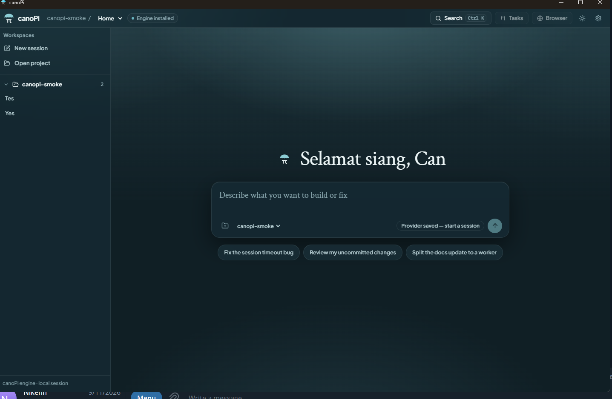

# canoPi Desktop

[](https://github.com/lustresense/canopi/releases)
[](https://tauri.app/)
[](https://www.microsoft.com/windows)
[](https://github.com/can1357/oh-my-pi)
[](#license--copyright-notice)
[](https://www.rust-lang.org/)
[](https://react.dev/)

**canoPi Desktop** is a glassmorphic, enterprise-grade Windows desktop client for AI coding agents, built on Tauri v2 with a headless OMP engine runtime and strict per-profile isolation.



---

## Overview & Key Value Proposition

canoPi Desktop runs AI coding agents natively on Windows — no terminal emulation, no Electron, no globally installed toolchain required on the end-user machine.

- **Enterprise endpoint security** — outbound transport is restricted to trusted endpoints; private-network and link-local targets are blocked by default.
- **Strict profile isolation** — each session/agent gets a dedicated WebView2 profile; cookies and storage are never shared between agents.
- **Fail-closed safety** — browser surfaces refuse to navigate unless policy hooks install successfully; data cleanup refuses paths it cannot prove ownership of.
- **Safe by default retention** — uninstall defaults to *Keep data*; explicit deletion requires a valid `.canopi-owner` marker and rejects junctions/reparse points.
- **Zero-secret persistence in UI state** — provider credentials are held by the engine's own config; the UI persists only an endpoint trust fingerprint, never API keys.

---

## Core Features

### Glassmorphic UI
React 19 + GSAP + Tailwind CSS interface: layered translucency, motion-driven transitions, and the approved `canopi-workspace` design language (React layout, logo and glass CSS preserved under `docs/ORIGINAL_CANOPI_WORKSPACE.jsx`).

### RPC-UI v2 Engine Protocol
The Tauri Rust host speaks the pinned OMP `rpc-ui` v2 protocol (JSONL stdio) with `cnp-engine.exe` over hidden child-process pipes — no ConPTY, no terminal simulation, no shell in the loop. Chunked frames (`rpc_chunk`) are reassembled with sequence/length validation and logical caps.

### Hierarchical Multi-Agent Kanban Board
Sessions → phases → tasks rendered as a hierarchical Kanban board. Multiple agents run concurrently with independent state, selection, and tool-activity feeds streamed through a buffered event queue.

### Fail-Closed Dedicated WebView2 Windows
Every agent browser surface opens as a dedicated Tauri WebView2 window with its own user-data directory. URL policy, popup policy, and permission policy are enforced in the backend; if policy hooks fail to install before initial navigation, the window **closes with zero navigation**. `file://`, `javascript:`, `data:`, and credentialed URLs are rejected. No external Chrome is ever launched.

### Enterprise Endpoint Security Overlay
Outbound requests are validated before first use:

- HTTPS for public endpoints by default; loopback HTTP supported and verified.
- Private (RFC 1918), link-local, and block-metadata targets blocked by default.
- Exact scheme/hostname/port confirmation required to trust a private endpoint; only a trust fingerprint is persisted — never the key.
- Hostname resolution before first request; resolved IPs in disallowed ranges are rejected.
- Redirect guards on the `transportFetch` overlay.

### Safe Data Retention by Default
Uninstall defaults to **Keep data**. Explicit Delete runs only through `src-tauri/windows/uninstall-data.ps1`, which requires a matching `.canopi-owner` marker, refuses junctions/reparse points, traverses only marker-owned canoPi folders, and writes a receipt to `%LOCALAPPDATA%\canoPi-uninstall-receipt.json` on failure. Existing OMP (`~/.omp`), 9Router settings, opened project folders, and other applications are never cleanup targets.

---

## Architecture

```
┌──────────────────────────────────────────────────────────────┐
│  React 19 + GSAP + Tailwind CSS   (Vite frontend)           │
│  Kanban board · settings · provider setup · activity feed   │
└───────────────────────────┬──────────────────────────────────┘
                            │ Tauri IPC (restricted capability)
┌───────────────────────────▼──────────────────────────────────┐
│  Tauri v2 Rust Host                                          │
│  RPC framing · endpoint trust registry · policy enforcement │
│  dedicated WebView2 windows · uninstall ownership checks    │
└───────────────────────────┬──────────────────────────────────┘
                            │ hidden child-process pipes (JSONL stdio)
┌───────────────────────────▼──────────────────────────────────┐
│  cnp-engine.exe  — headless OMP 18.6.1 runtime              │
│  agent sessions · tool execution · provider transport       │
└──────────────────────────────────────────────────────────────┘
```

| Layer | Role |
| --- | --- |
| **React 19 + GSAP + Tailwind CSS** | Presentation: glassmorphic UI, Kanban hierarchy, motion. Talks only to the Rust host via Tauri IPC. |
| **Tauri v2 Rust Host** | Security boundary: validates RPC frames, enforces endpoint trust and URL policy, owns WebView2 windows, gates destructive file operations. |
| **`cnp-engine.exe`** | Headless OMP 18.6.1 runtime (pinned upstream commit `2a2c6dcb…`), runs as a child process over hidden pipes; holds provider config and executes agent sessions. |

The engine binary is built from the pinned OMP commit and revalidated by SHA-256 provenance (`ENGINE-PROVENANCE.json`); the GUI never depends on a globally installed `omp`.

---

## Installation

Prebuilt NSIS installer (Windows x64):

```
release/canoPi-Setup-1.0.0-win-x64.exe
```

**Interactive install:** run the installer and follow the prompts.

**Silent install:**

```powershell
.\release\canoPi-Setup-1.0.0-win-x64.exe /S
```

**Silent uninstall** (defaults to *Keep data*):

```powershell
& "$env:LOCALAPPDATA\canoPi\Uninstall canoPi.exe" /S
```

> The build is unsigned; SmartScreen warnings are expected. Verify `SHA256SUMS.txt` (`EA3332A42B95FF6978A392CF43CC641677A1D22C2D33E8E15BC58D706B81C747` for the installer) before use.

---

## Building from Source

### System prerequisites

- Windows 10/11 x64
- Node 22+
- Bun 1.3.14+
- Python 3.10+
- Rust toolchain (GNU or MSVC) with matching C++/Windows SDK prerequisites
- Git, internet connection

### Step-by-step

```powershell
# 1. Clone the repository
git clone https://github.com/lustresense/canopi.git
cd canopi

# 2. Install frontend dependencies
bun install            # or: npm install

# 3. Full verified release build (engine provenance, tests, NSIS package)
.\BUILD-WINDOWS.cmd
```

`BUILD-WINDOWS.cmd` audits version/lockfile identity, builds or revalidates the pinned OMP commit as `cnp-engine.exe`, checks a live RPC v2 handshake, runs the Node and Rust test suites, compiles the React frontend and Rust host, packages the NSIS installer, verifies silent install/uninstall with default *Keep data*, and only then publishes `release/` with `BUILD-MANIFEST.json`, `SHA256SUMS.txt`, and `ENGINE-PROVENANCE.json`.

Faster inner loops:

```powershell
bun run dev             # Vite dev server (127.0.0.1:1420, strict port)
bun run desktop         # tauri dev
bun run package:windows # tauri build --bundles nsis
```

CI equivalent: `.github/workflows/windows-build.yml` on a Windows runner; artifacts upload only after successful checks.

---

## Configuration & Model Providers

canoPi's isolated profile does **not** implicitly clone OMP settings. Configure providers in-app:

| Provider | Notes |
| --- | --- |
| **Anthropic** | Native API, key stored by engine config |
| **OpenAI** | Native API |
| **OpenRouter** | Aggregated models |
| **9Router** | Local routing proxy (e.g. `http://127.0.0.1:9090/v1`) |
| **Custom API proxies** | OpenAI-compatible base URL + key |

- The GUI can optionally import provider *model definitions* from 9Router; auth SQLite files are **never** auto-imported. Explicit login/provider setup is still required for credentials held there.
- **Zero-secret persistence guarantee:** UI state stores endpoint trust fingerprints only. API keys live exclusively in the engine's provider config and are never written to frontend storage, logs, or screenshots.

---

## Testing & Verification

| Suite | Count | Command |
| --- | --- | --- |
| Node tests | **76 passing** | `bun run test` (`node --test src/runtime/*.test.mjs tests/*.test.mjs`) |
| Rust tests | **51 tests** | `cargo test` in `src-tauri/` |
| Pipeline verification | full gate | `.\BUILD-WINDOWS.cmd` |

The release pipeline additionally verifies: patched fork diff, engine provenance against the pinned clone, live RPC v2 handshake smoke (no provider secrets needed), Rust compile + test, uninstall data cleanup on disposable profiles, and silent install/uninstall lifecycle with Keep-data default. Recorded results: `BUILD_AND_E2E_REPORT.md`, `release/BUILD-MANIFEST.json`.

---

## Security & Isolation Model

- **Loopback-only HTTP** — non-loopback plain HTTP is rejected; public endpoints require HTTPS; private ranges need explicit exact-endpoint trust.
- **Trusted endpoints registry** — persisted per profile as fingerprints; unknown endpoints fail closed before the first request.
- **Private network protection** — RFC 1918, link-local (169.254/16), and metadata addresses blocked by default; hostname resolution checked against allowed ranges; redirect guards.
- **Dedicated WebView2 windows** — per session+agent user-data directories; backend-enforced URL/popup/permission policy; fail-closed before initial navigation.
- **Restricted Tauri IPC** — capability file exposes only the main window with minimal commands (restricted IPC + user-initiated folder picker).
- **Uninstaller refusal of junctions** — cleanup rejects reparse points/junctions and paths lacking a `.canopi-owner` marker; receipts written on failure; default is Keep data.
- **No secrets in UI state** — trust fingerprints only; engine pipes are hidden (no ConPTY/shell exposure).

---

## License & Copyright Notice

canoPi Desktop is released under the [MIT License](LICENSE).

- **canoPi Desktop** — Copyright (c) 2026 Lustresense. MIT License.
- **Upstream Engine (Oh My Pi / `cnp-engine`)** — Copyright (c) 2025-2026 Can Bölük, Copyright (c) 2026 Stencil Labs, Inc. MIT License.
- **Foundational Architecture (Pi Agent / `pi-mono`)** — Copyright (c) 2025 Mario Zechner. MIT License.

Full third-party notices are referenced in `src-tauri/resources/licenses/`; the Windows source-build workflow injects the exact pinned upstream notices (`LICENSE-OMP.txt`, `THIRD-PARTY-NOTICES-OMP.txt` and related files) there before Tauri compilation.
