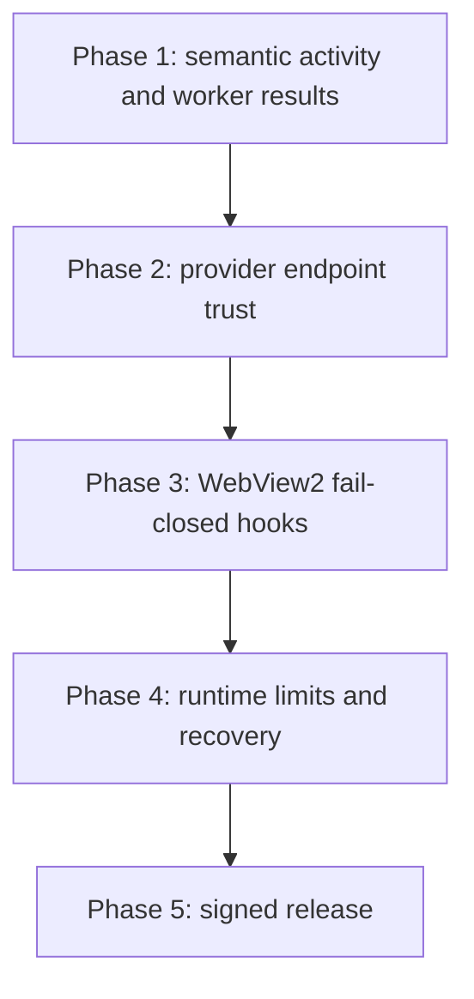

# canoPi — Execution Plan

**Status:** audit only. No application behavior changed by this document.

**Trigger:** execute only after the user explicitly requests implementation.

## Observed baseline

- Real canoPi session works: main agent, subagents, task board, inspector, browser surface, native engine connection.
- Bundled `cnp-engine.exe` is intentionally built from pinned OMP. Seeing OMP-shaped tool events inside activity is expected engine protocol behavior; it must not become a visible terminal or require global `omp.exe`.
- Current release artifacts passed packaging, silent install/uninstall, JS and Rust tests.
- Current UI issue: activity is a raw tool/event log. Desired behavior:
  - Tool use shows concise semantic activity, not CLI/JSON payloads.
  - Assistant/subagent final output appears as a normal chat/transcript message.
  - Full arguments and raw result remain available only behind an explicit detail disclosure.

## Non-negotiable invariants

1. No user-facing terminal, shell, PTY, global `omp.exe`, or PATH installation.
2. `cnp-engine.exe` stays a bundled hidden child using RPC pipes.
3. Never send a prompt until a catalog model is selected successfully.
4. Never store provider secrets in frontend workspace/localStorage.
5. Preserve canonical OMP `models.yml` behavior for OpenAI-compatible/custom providers.
6. Never silently relax browser, data-delete, import, URL, or approval policy.
7. Tests must exercise consumer-visible state transitions; no source-string-only regression tests.

## Phase 1 — Subagent output UX

### Problem

`tool_execution_start` / `tool_execution_end` and `subagent_event` already reach `src/app/CanoPi.jsx`. The dock currently renders flat `time | verb | argument | status` traces, so tool payloads resemble terminal/CLI logs. Assistant final text is folded into per-agent transcripts, but the outcome is not visually distinguished from tool activity and early worker history can be missed before polling settles.

### Decision

Keep raw protocol data separate from user-facing projection.

| Surface | Show by default | Hidden detail |
|---|---|---|
| Activity dock | Time, agent, semantic action, compact target, status | Full JSON args, tool result, error body |
| Main transcript | User/assistant conversation, tool card with one-line status | Tool args/result on expand |
| Worker inspector chat | Worker assistant reasoning/final message as chat | Tool details on expand |
| Task board | OMP task state only | No synthetic task state |

### Implementation

1. Add a pure `projectToolActivity(frame)` module.
   - Map known tool events to verbs such as `Reading`, `Searching`, `Editing`, `Running`, `Creating`, `Checking`, `Waiting`.
   - Extract safe short targets (`path`, `query`, command title) instead of stringifying raw JSON by default.
   - Preserve `toolCallId`, owner, start/end time, status, bounded output/error metadata.
   - Unknown tools use `Running <toolName>`; do not invent semantics.
2. Correlate start/end by `toolCallId`.
   - One visible activity row per invocation.
   - Start gives `running`; end updates the same row to `ok`, `error`, or `denied`.
   - Never append a duplicate row on delayed/out-of-order end frames.
3. Ensure per-worker transcript reconciliation.
   - On `subagent_lifecycle: completed|failed|aborted`, call `get_subagent_messages` once after the terminal lifecycle event.
   - Fold canonical assistant `message_end` content by message ID.
   - Render final non-empty assistant content as a normal chat result in that worker’s inspector.
   - Never fabricate a “final answer” when OMP emitted none.
4. Update dock renderer.
   - Replace raw JSON log line with structured table/list row.
   - Expand row only on click/keyboard activation.
   - Add an accessible copy action for raw data; do not expose it by default.
5. Bound retention.
   - Cap traces per agent (recommended: 1,000) and messages per agent (recommended: 2,000) with oldest-first eviction.
   - Keep an explicit, visible “older activity not retained locally” marker.
   - Preserve active running tool rows through eviction.

### Tests

- Start/end correlation updates one row, not two.
- Subagent final `message_end` becomes one assistant transcript entry.
- Full `message_end` repairs lost stream delta.
- Unknown tool remains safe/readable without raw JSON default.
- Out-of-order and stale-generation frames do not corrupt another session.
- Retention cap never evicts a running tool row and never persists raw provider secrets.

### Manual proof

Run a disposable project with one `scout` and one `task` worker. Verify:

1. Activity shows `Reading <path>` / `Searching <query>` rather than JSON payload.
2. Expanded tool row shows raw args/result only on demand.
3. Worker final outcome appears under that worker’s **Chat** tab.
4. Reconnect during an active worker leaves no duplicate rows or duplicate messages.

## Phase 2 — Provider/custom endpoint security

### Findings

- `validate_http_url` accepts arbitrary `http://` and `https://` targets, including non-loopback private/link-local addresses. The selected endpoint receives API key and prompts.
- Importing OMP model definitions is intentionally opt-in and now sanitizes legacy `openai-chat`, but imported `baseUrl` and API key remain active configuration.
- Provider keys are plaintext inside canoPi’s app-owned `models.yml` because the engine consumes OMP’s file-backed model schema.

### Decision

Use strict endpoint policy while preserving local OpenAI-compatible proxies.

1. Allow `https://` public endpoints.
2. Allow `http://` only for verified loopback (`localhost`, `127.0.0.1`, `::1`).
3. Block metadata/link-local and other private network targets by default.
4. Add an **Advanced: trust private endpoint** confirmation for LAN/self-hosted proxies. Display exact scheme, hostname, port, and security consequence: “This endpoint receives your API key and prompts.” Persist only an endpoint trust fingerprint, never the key in UI state.
5. Resolve hostnames before first request and reject disallowed resolved IP ranges. Re-check redirects/DNS rebinding where the transport supports it.
6. Import preview must list every provider endpoint and whether a key is present before import confirmation. User can uncheck providers; import is not all-or-nothing.
7. Restrict file permissions/ACL for canoPi-owned profile files to current user where Windows supports it. Document the remaining same-user threat: OMP-compatible file config requires engine-readable plaintext.

### Tests

- HTTPS public endpoint accepted.
- `http://127.0.0.1` and `[::1]` accepted.
- HTTP non-loopback rejected.
- Link-local, metadata, RFC1918, malformed URL/userinfo, encoded-host, DNS redirect/rebinding cases rejected unless explicit trust decision is present.
- Import preview discloses provider endpoint/key presence without displaying key material.
- Imported legacy `openai-chat` normalizes to `openai-completions`; unknown API fails closed.
- Workspace/localStorage never contains API key, trust token, or raw imported config.

## Phase 3 — WebView2 fail-closed policy

### Finding

`src-tauri/src/native/webview2.rs` currently discards HRESULT failures when registering navigation, popup, and permission policy hooks. A browser surface can navigate after apparent setup success without confirmed enforcement.

### Implementation

1. Propagate failures from every policy-hook registration.
2. If one hook fails, close the just-created browser surface before first external navigation.
3. Make `browser::open` return the hook error; never navigate in this state.
4. Add a test seam that forces each registration failure separately.
5. Add manual proof: blocked non-HTTPS/non-loopback navigation, denied popup, denied camera/microphone/location/notification.

## Phase 4 — Runtime resilience and resource limits

1. Keep existing dialog-clear/reconnect repair. Add an end-to-end native test that kills the engine while an approval dialog is visible, then confirms reconnect remains clickable.
2. Enforce a bounded UI event admission queue per session. On overflow: drop only non-critical progress events, retain lifecycle/message end/error, and show a single “activity condensed” notice.
3. Canonicalize and constrain all session transcript file paths accepted through RPC before use. Require containment under app-owned session roots where the protocol permits.
4. Add explicit “Clear local session history” control. It removes only canoPi-owned serialized workspace/session UI metadata, never project files, global OMP config, provider config, or engine data unless user separately requests it.
5. Add install-upgrade smoke: old profile, imported provider definition, active stale dialog state, then upgrade/reconnect; verify no lockout and no silent config mutation.

## Phase 5 — Release integrity

### Blocker

Current Windows release is unsigned. SHA-256 is useful for manual verification but does not give Windows publisher identity or tamper protection after distribution.

### Implementation

1. Obtain a code-signing certificate and expected thumbprint through the release owner.
2. Authenticode-sign `canoPi.exe`, `cnp-engine.exe`, uninstaller, and NSIS installer.
3. Timestamp signatures using RFC 3161.
4. Add pipeline gate:
   - `Get-AuthenticodeSignature` is `Valid`.
   - Subject/thumbprint match configured expected values.
   - All shipped executables have the same expected publisher.
5. Publish SHA-256 checksum plus signer identity in release notes.

## Phase order

## Final acceptance gate

- No visible terminal or global OMP dependency.
- Main and worker outputs readable as chat; tool activity concise by default.
- Custom OpenAI-compatible endpoint works only under disclosed endpoint-trust policy.
- Import cannot silently activate unknown transport or undisclosed endpoint.
- Browser policy registration failure prevents navigation.
- Long-running session stays bounded in memory/localStorage.
- Reconnect remains clickable after engine death, approval dialog, session change, and provider failure.
- Full JS/Rust tests plus installer lifecycle pass.
- Installed build is Authenticode-valid before public distribution.
